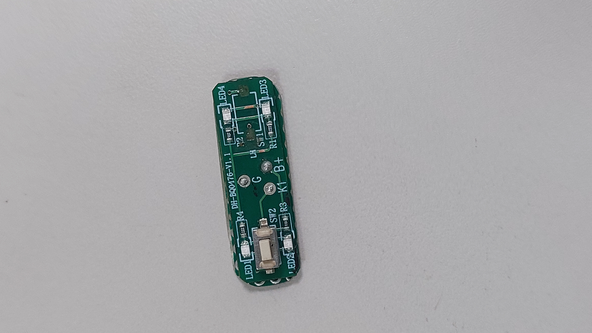
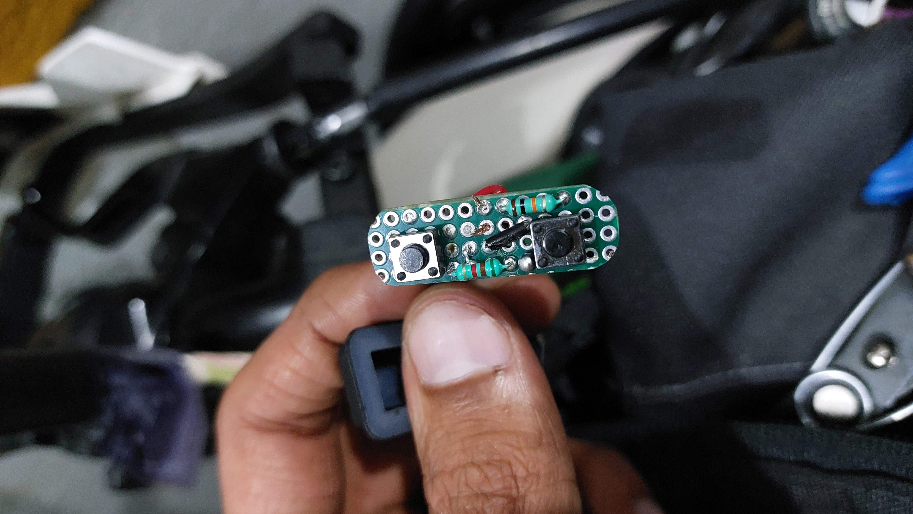
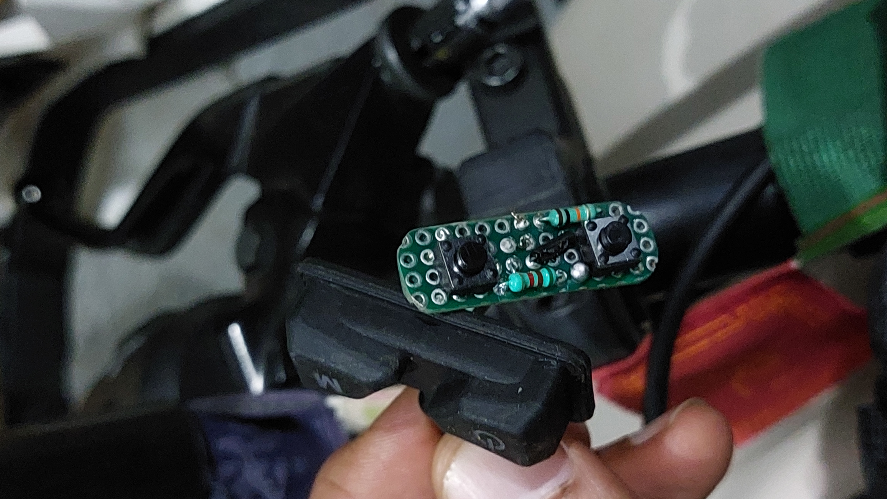

# 🎮 Fog Lamp Side Quest

> A broken OEM switch, a little PCB reverse engineering, a perfboard repair, and a 12-hour hardware side quest.

A friend's bike fog-lamp switch stopped working because the pushbuttons on its original PCB had failed. Instead of replacing the entire assembly, I opened it up, traced the PCB connections, measured the resistors, and built a replacement.

The repair and initial KiCad design took approximately **12 hours**, alongside my other work.

## 📸 Build Gallery

### 1. The Original Problem

The damaged OEM PCB that started the side quest.

### 2. Understanding the Original Design

I traced the PCB tracks by hand, documented the connections, and measured the resistors to understand how the original circuit worked.

### 3. OEM Board vs. Perfboard Replacement

I measured the original board and shaped a double-sided perfboard to match its dimensions. Then I positioned the pushbuttons, added the resistors, and soldered the connections.

### 4. Back on the Bike

The replacement was fitted into the existing switch assembly and tested on the bike.

### 5. Rear View of the Installation

A view of the completed repair from the back.

### 6. Installed with the Original Mount

The replacement fitted into the original mounting arrangement.

## 🛠️ What I Did

- Inspected the failed OEM switch PCB.
- Reverse-engineered the board's connections without an original schematic.
- Traced and documented PCB tracks manually.
- Measured the resistors and analysed the circuit.
- Built a dimension-matched, double-sided perfboard replacement.
- Installed and tested the repair using the original switch mount.
- Designed a replacement schematic and PCB layout in KiCad 9.0.

## 🧰 Tools & Materials

- KiCad 9.0
- Double-sided perfboard
- Pushbuttons and resistors
- Soldering tools
- Multimeter
- Pen-and-paper track tracing

## 🏁 Quest Status

- [x] Inspect the original PCB
- [x] Trace the circuit connections
- [x] Build the perfboard replacement
- [x] Install and test the repair
- [x] Design the schematic and PCB layout in KiCad
- [ ] Fabricate and validate the custom PCB

## 💡 What I Learned

- PCB reverse engineering without an existing schematic
- Practical circuit analysis and component measurement
- Translating a physical PCB into a replacement layout
- Soldering and fitting a prototype within existing mechanical constraints
- Moving from a quick repair to a documented PCB design

## Notes

This is a personal repair and learning project. The successful test refers to the installed perfboard prototype; the custom PCB design is a separate step and should be marked complete only after fabrication and testing.

The original OEM product is not my design. This repository documents my repair process and replacement design. Any third-party rights remain with their respective owners.

---

**Side quest completed in approximately 12 hours.** 🔧
